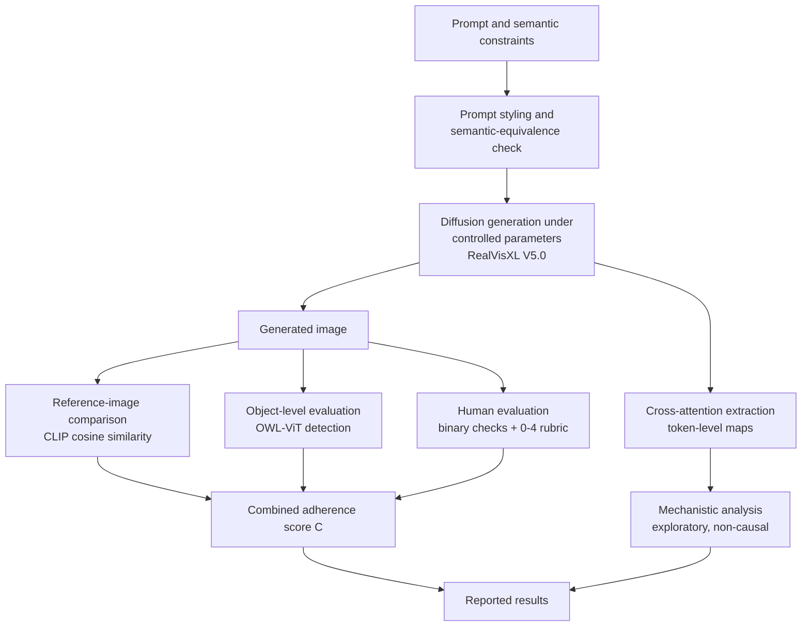

# Prompt Adherence in Text-to-Image Diffusion Models

### Prompt Styling, Reference-Guided Evaluation, and Cross-Attention Analysis


**Author:** Devarsh Nayyar
Department of Computer Science and Engineering, Indian Institute of Technology (ISM) Dhanbad, India

---

## Table of Contents

1. [Overview](#overview)
2. [Key Contributions](#key-contributions)
3. [Research Questions](#research-questions)
4. [Framework Pipeline](#framework-pipeline)
5. [Experimental Setup](#experimental-setup)
6. [Evaluation Methodology](#evaluation-methodology)
7. [Cross-Attention Analysis](#cross-attention-analysis)
8. [Results](#results)
9. [Limitations](#limitations)
10. [Getting Started](#getting-started)
11. [Repository Structure](#repository-structure)
12. [References](#references)
13. [Citation](#citation)

---

## Overview

Text-to-image diffusion models can produce visually convincing images while still violating the semantic constraints of a prompt: they may omit objects, attach attributes to the wrong object, or get spatial relations wrong.

This project proposes an experimental framework that separates **observable image correctness** from **internal attention behavior**, using four complementary lenses:

| Lens | Question it answers |
|---|---|
| Prompt styling | Does rewording a semantically equivalent prompt change adherence? |
| Reference-image similarity | How close is the output to a chosen target image? |
| Object detection + human judgment | Are the requested objects and attributes actually present and correctly bound? |
| Cross-attention maps | Where does each prompt token attend during denoising? |

The test prompt is **"A red ball; A blue cube"**. It needs two objects and two correct color-object bindings, so a red cube with a blue ball counts as a failure.

> **Pilot study.** The parameter experiment uses one prompt, one checkpoint and 27 images. Results do not generalize to all prompt types.

---

## Key Contributions

- A **prompt-styling framework** that varies the wording of a prompt while preserving its semantic constraints.
- A **reference-guided evaluation** procedure that complements object-level and human judgments.
- A **normalized combined score** that summarizes four complementary adherence signals.
- A **controlled CFG × denoising-step experiment** (27 generations, fixed prompt).
- A **cross-attention analysis** procedure for token-level spatial attention maps.

---

## Research Questions

| ID | Topic | Question |
|---|---|---|
| RQ1 | Prompt styling | Does changing the textual organization of a semantically equivalent prompt change observed adherence? |
| RQ2 | Reference-guided evaluation | How does similarity to a reference image relate to object-level and human-rated adherence? |
| RQ3 | Parameter sensitivity | How do CFG scale and denoising-step count relate to detection scores and attribute binding? |
| RQ4 | Mechanistic analysis | How do token-level cross-attention maps vary across settings, and do they correspond to adherence differences? |

The parameter experiment directly addresses **RQ3**. The other questions define the broader framework and should only be described as answered once their experiments are complete.

---

## Framework Pipeline



### Prompt styling variants

| Style | Description |
|---|---|
| Baseline | The original natural-language prompt |
| Entity-first | Requested entities stated clearly and directly |
| Attribute-explicit | Each attribute placed immediately beside its entity |
| Line-separated | Each entity-attribute pair on its own line |
| Concise | Redundant wording removed without deleting any constraint |

The prompt used in the parameter experiment is fixed across all 27 configurations:

```
A red ball
A blue cube
```

**Semantic constraints:** (1) a ball is present, (2) the ball is red, (3) a cube is present, (4) the cube is blue.

### Reference image

The reference image defines the target composition and is used **for evaluation only**. It is not used to fine-tune or condition the model.

<p align="center">
  <br>
  <em>Reference image defining the target composition</em>
</p>

---

## Experimental Setup

Full-factorial design: 3 CFG scales × 3 step counts × 3 seeds.

| Parameter | Value |
|---|---|
| Model | RealVisXL V5.0 (`SG161222/RealVisXL_V5.0`, SDXL-based) |
| CFG scale | 3, 7.5, 12 |
| Denoising steps | 20, 30, 40 |
| Random seeds | 42, 123, 2026 |
| Resolution | 1024 × 1024 |
| Prompt | `A red ball` / `A blue cube` |
| Unique CFG-step pairs | 9 |
| Images per pair | 3 |
| **Total images** | **27** |

$$N = N_{CFG} \times N_{steps} \times N_{seeds} = 3 \times 3 \times 3 = 27$$

**Controlled variables:** prompt text and formatting, model checkpoint, reference image, resolution, scheduler and other inference settings, negative prompt (if used), software environment, evaluation procedure.

**Varied:** CFG scale, denoising steps and random seed only. Matched seeds allow paired comparisons, but changing inference settings changes the whole sampling trajectory, so outputs are not identical apart from one isolated parameter.

---

## Evaluation Methodology

### Evaluation dimensions

| # | Dimension | What it checks |
|---|---|---|
| 1 | Object presence | Are both requested objects present? |
| 2 | Attribute binding | Is the ball red and the cube blue? |
| 3 | Reference similarity | Is the image visually similar to the reference? |
| 4 | Overall adherence | Does the image satisfy all constraints as a whole? |
| 5 | Mechanistic attention | How does token-level attention change during denoising? (analyzed separately) |

### Object detection (OWL-ViT)

The text queries `"a red ball"` and `"a blue cube"` are run and the maximum detection score is recorded for each ($S_b$, $S_c$).

$$S_{min} = \min(S_b, S_c)$$

$$D = \begin{cases} 1, & S_b \ge \tau \text{ and } S_c \ge \tau \\ 0, & \text{otherwise} \end{cases} \qquad \tau = 0.1 \text{ (provisional)}$$

The threshold is an operational choice, not a validated correctness measure. Detection also does not prove that each color is attached to the right shape.

### Reference-image similarity (CLIP)

$$S_{ref} = \frac{z_g^\top z_r}{\lVert z_g \rVert_2 \, \lVert z_r \rVert_2}, \qquad R_{ref} = \text{clip}\left(\frac{S_{ref}+1}{2}, 0, 1\right)$$

### Human evaluation

Five binary checks per image: ball present, cube present, ball red, cube blue, both clearly distinguishable. An overall 0-4 rubric is also assigned.

| Score | Description |
|---|---|
| 0 | Mostly incorrect or missing required content |
| 1 | Several major constraints are violated |
| 2 | Partial adherence; some constraints are satisfied |
| 3 | Nearly all constraints are satisfied |
| 4 | All required constraints are clearly satisfied |

Normalized as $H = h/4$.

### Combined score

$$C = w_D D + w_A A + w_R R_{ref} + w_H H, \qquad \sum w_i = 1,\ w_i \ge 0$$

| Symbol | Component |
|---|---|
| $D$ | Both objects exceed the detection threshold |
| $A$ | Attribute binding (1 only if both color-object pairs are correct) |
| $R_{ref}$ | Normalized reference-image similarity |
| $H$ | Normalized human overall-adherence rating |

Equal weights ($w = 0.25$ each) are used as a transparent exploratory baseline, not an optimum. Component scores should always be reported next to $C$, so a high reference similarity cannot hide a binding failure.

---

## Cross-Attention Analysis

Cross-attention uses image features as queries and text token embeddings as keys and values:

$$\text{Attn}(Q,K,V) = \text{softmax}\left(\frac{QK^\top}{\sqrt{d}}\right)V$$

The analysis focuses on the tokens **"red"**, **"ball"**, **"blue"** and **"cube"**.

| Step | Procedure |
|---|---|
| Extraction | Store attention probabilities for each token, reshape to the feature resolution, record layer, resolution, token index, step, CFG and seed |
| Visualization | Resize maps to image size and overlay on the output |
| CFG comparison | Fix prompt, seed and step count; compare maps across CFG values |
| Step comparison | Align maps by relative denoising phase (early / middle / late), not by raw step index |
| Statistics | Normalize each map, then compute spatial entropy |

$$\tilde{M}_t(i,j) = \frac{M_t(i,j)}{\sum_{i,j} M_t(i,j) + \epsilon}, \qquad H(M_t) = -\sum_{i,j} \tilde{M}_t(i,j)\log\big(\tilde{M}_t(i,j)+\epsilon\big)$$

> Attention maps are **exploratory indicators, not causal explanations**. Causal claims would require controlled interventions, such as modifying attention weights.

### Example token-level attention maps (pipeline demonstration)

<p align="center">
  
  
  <br>
  <em>Generated image and token-level cross-attention maps (apple and vase tokens)</em>
</p>

<p align="center">
  
  
  <br>
  <em>Attention across CFG = 3.0, 7.5 and 12.0 (Steps = 30, Seed = 42)</em>
</p>

---

## Results

> **Please read before citing numbers.**
> The numbers below are copied from the paper's tables and figures. Several figures in the paper (Graphs 1-4 and the prompt-styling table) are labeled *synthetic illustrative values - not measured results*. Fig. 3-4 also use an apple/vase example, not the red ball / blue cube prompt. Replace these with your recorded measurements before treating any of this as an empirical finding.

### Completion status

| Measure | Value |
|---|---|
| Planned generations | 27 |
| Successfully generated | _to fill in_ |
| Failed generations | _to fill in_ |
| Images evaluated | _to fill in_ |
| Reference image selected | Yes (see figure above) |
| Human ratings completed | _to fill in_ |
| Attention maps captured | _to fill in_ |

### Complete quantitative evaluation (27 configurations)

Columns: **Ball** and **Cube** are the OWL-ViT query scores, $D$ is detection, $A$ is attribute binding, $R_{ref}$ is normalized reference similarity, $H$ is the normalized human score, and $C$ is the combined score.

| CFG | Steps | Seed | Ball | Cube | D | A | R_ref | H | C |
|---|---|---|---|---|---|---|---|---|---|
| 3 | 20 | 42 | .78 | .72 | .75 | .68 | .71 | .70 | .708 |
| 3 | 20 | 123 | .74 | .76 | .75 | .70 | .73 | .72 | .720 |
| 3 | 20 | 2026 | .81 | .69 | .75 | .65 | .70 | .68 | .692 |
| 3 | 30 | 42 | .82 | .78 | .80 | .75 | .76 | .76 | .766 |
| 3 | 30 | 123 | .79 | .81 | .80 | .73 | .78 | .74 | .758 |
| 3 | 30 | 2026 | .76 | .74 | .75 | .70 | .74 | .72 | .726 |
| 3 | 40 | 42 | .84 | .80 | .82 | .77 | .79 | .78 | .788 |
| 3 | 40 | 123 | .80 | .82 | .81 | .75 | .77 | .76 | .770 |
| 3 | 40 | 2026 | .83 | .77 | .80 | .76 | .80 | .77 | .780 |
| 7.5 | 20 | 42 | .87 | .84 | .855 | .82 | .83 | .82 | .829 |
| 7.5 | 20 | 123 | .83 | .86 | .845 | .80 | .81 | .81 | .817 |
| 7.5 | 20 | 2026 | .89 | .82 | .855 | .84 | .84 | .83 | .839 |
| 7.5 | 30 | 42 | .93 | .90 | .915 | .91 | .90 | .92 | .911 |
| 7.5 | 30 | 123 | .89 | .92 | .905 | .88 | .89 | .90 | .895 |
| 7.5 | 30 | 2026 | .91 | .88 | .895 | .90 | .92 | .89 | .899 |
| 7.5 | 40 | 42 | .90 | .88 | .89 | .87 | .88 | .88 | .880 |
| 7.5 | 40 | 123 | .88 | .91 | .895 | .89 | .87 | .90 | .891 |
| 7.5 | 40 | 2026 | .92 | .86 | .89 | .85 | .89 | .87 | .876 |
| 12 | 20 | 42 | .86 | .80 | .83 | .78 | .80 | .79 | .798 |
| 12 | 20 | 123 | .82 | .84 | .83 | .81 | .78 | .80 | .804 |
| 12 | 20 | 2026 | .88 | .79 | .835 | .79 | .82 | .81 | .813 |
| 12 | 30 | 42 | .90 | .86 | .88 | .85 | .86 | .85 | .858 |
| 12 | 30 | 123 | .87 | .89 | .88 | .83 | .84 | .86 | .854 |
| 12 | 30 | 2026 | .91 | .84 | .875 | .86 | .87 | .84 | .857 |
| 12 | 40 | 42 | .85 | .82 | .835 | .80 | .82 | .81 | .815 |
| 12 | 40 | 123 | .88 | .84 | .86 | .82 | .81 | .83 | .830 |
| 12 | 40 | 2026 | .83 | .86 | .845 | .79 | .83 | .82 | .821 |

### Mean combined score per configuration

Averaged over the 3 seeds (n = 3 per cell, so treat as descriptive only).

| CFG | Steps | Mean C |
|---|---|---|
| 3 | 20 | 0.707 |
| 3 | 30 | 0.750 |
| 3 | 40 | 0.779 |
| 7.5 | 20 | 0.828 |
| 7.5 | 30 | 0.902 |
| 7.5 | 40 | 0.882 |
| 12 | 20 | 0.805 |
| 12 | 30 | 0.856 |
| 12 | 40 | 0.822 |

In this table, **CFG 7.5 with 30 steps** has the highest mean combined score, and CFG 3 the lowest at every step count. CFG 12 scores below 7.5, which fits the paper's point that higher guidance does not guarantee better adherence. With three seeds per cell this is an observation, not a significance claim.

<details>
<summary><b>Illustrative graphs from the paper (synthetic placeholder values)</b></summary>

<br>

These plots are labeled *synthetic illustrative values* in the paper and show the intended layout only.

<p align="center">
  <br>
  <em>Graph 1 - Mean combined score by configuration (synthetic)</em>
</p>

<p align="center">
  <br>
  <em>Graph 2 - Reference similarity vs object detection (synthetic)</em>
</p>

<p align="center">
  <br>
  <em>Graph 3 - CFG scale vs adherence (synthetic)</em>
</p>

<p align="center">
  <br>
  <em>Graph 4 - Denoising steps vs adherence (synthetic)</em>
</p>

</details>

### Statistical summary approach

For each configuration (n = 3):

$$\bar{x} = \frac{1}{n}\sum_{i=1}^{n} x_i, \qquad s^2 = \frac{1}{n-1}\sum_{i=1}^{n}(x_i-\bar{x})^2, \qquad \bar{x} \pm t_{0.975,\,n-1}\frac{s}{\sqrt{n}}$$

Intervals will be wide. For the binary outcome $D$, report counts and proportions with a Wilson interval. No statistical significance should be claimed unless a suitable paired analysis has been run.

---

## Limitations

| # | Limitation |
|---|---|
| 1 | One prompt and 27 images; three seeds give only a limited view of sampling variability |
| 2 | OWL-ViT scores are indirect and do not verify exact colors or color-object binding; the threshold is provisional |
| 3 | Reference similarity depends on the chosen reference and encoder |
| 4 | The combined score depends on normalization and weights; different weights may change rankings |
| 5 | Human ratings can be subjective, especially with a single reviewer |
| 6 | Attention extraction depends on the library, layers, resolutions and aggregation |
| 7 | Prompt styling, reference-guided evaluation and interventions are separate procedures; planned work must not be reported as completed |

---

## Getting Started

> Adapt this section to your actual code.

```bash
git clone https://github.com/<your-username>/<repo-name>.git
cd <repo-name>
pip install torch diffusers transformers accelerate
```

```python
import torch
from diffusers import StableDiffusionXLPipeline

pipe = StableDiffusionXLPipeline.from_pretrained(
    "SG161222/RealVisXL_V5.0", torch_dtype=torch.float16
).to("cuda")

prompt = "A red ball\nA blue cube"
for cfg in [3, 7.5, 12]:
    for steps in [20, 30, 40]:
        for seed in [42, 123, 2026]:
            g = torch.Generator("cuda").manual_seed(seed)
            img = pipe(prompt, guidance_scale=cfg, num_inference_steps=steps,
                       height=1024, width=1024, generator=g).images[0]
            img.save(f"outputs/cfg{cfg}_steps{steps}_seed{seed}.png")
```

---

## Repository Structure

```
.
├── README.md
├── images/                 # Figures used in this README
├── paper/
│   └── Research_paper.pdf
├── generation/             # Image generation scripts
├── evaluation/             # OWL-ViT, CLIP and scoring code
├── attention/              # Cross-attention extraction and visualization
└── outputs/                # Generated images and metadata
```

---

## References

1. J. Ho, A. Jain, P. Abbeel. *Denoising Diffusion Probabilistic Models.* NeurIPS, vol. 33, 2020.
2. J. Ho, T. Salimans. *Classifier-Free Diffusion Guidance.* arXiv:2207.12598, 2022.
3. R. Rombach et al. *High-Resolution Image Synthesis with Latent Diffusion Models.* CVPR, 2022.
4. A. Radford et al. *Learning Transferable Visual Models From Natural Language Supervision.* ICML, 2021.
5. M. Minderer et al. *Simple Open-Vocabulary Object Detection with Vision Transformers.* ECCV, 2022.
6. H. Chefer, S. Gur, L. Wolf. *Attend-and-Excite: Attention-Based Semantic Guidance for Text-to-Image Diffusion Models.* ACM TOG, vol. 42, no. 4, 2023.

---

## Citation

```bibtex
@misc{nayyar2026promptadherence,
  title  = {Prompt Adherence in Text-to-Image Diffusion Models: Prompt Styling,
            Reference-Guided Evaluation, and Cross-Attention Analysis},
  author = {Nayyar, Devarsh},
  year   = {2026},
  note   = {Indian Institute of Technology (ISM) Dhanbad}
}
```
